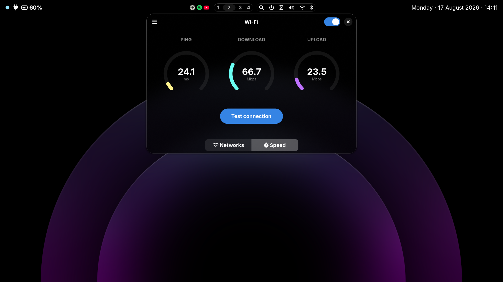
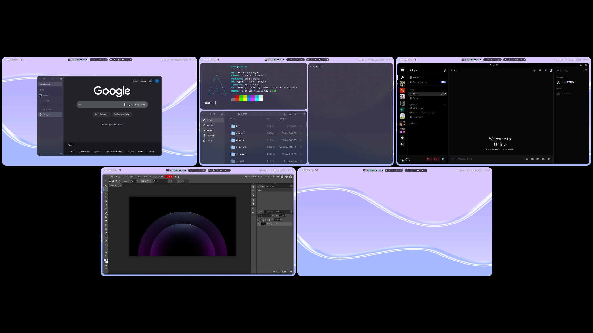
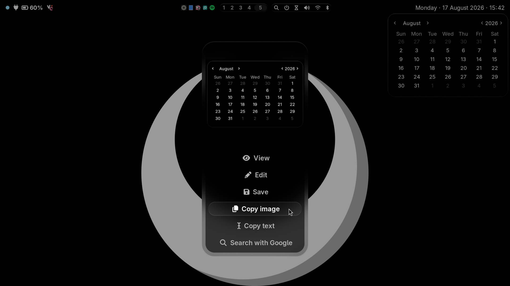
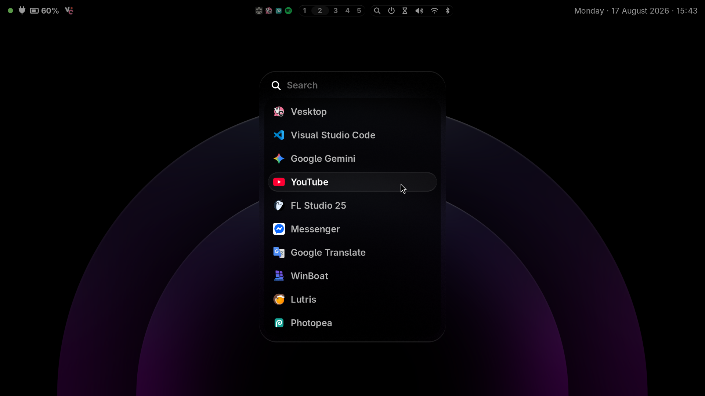

Veri is a minimal but polished and visually pleasing setup on top of Arch Linux and Hyprland. It is aimed at experienced users who want freedom and options, but also value their time. The project's policy and architecture support tweaking every single aspect of an Arch Linux system, while providing a stable baseline for the configuration of a modern desktop.






### Notable features

- Complete minimal desktop largely based on GTK apps
- Extensive navigation and intuitive workspace management
- Unified search (applications, shell, web search, and calculator), powered by Rofi
- Shell setup powered by Zsh
- Multiple touchpad gestures, including volume and screen brightness control
- Desktop level zoom
- Screenshot tool with text recognition and Google Lens features
- Desktop recording tool
- Visual software management powered by Pamac
- Control over charging for laptop batteries
- Clipboard history with images
- Emoji and unicode picker

### Notice

Due to Arch Linux' nature things may change over time or break, affecting this project. There is no all time guarantee of stability of new installs, however I will attempt to deliver hotfixes as quickly as possible. See more at the end of the installation guide.

# Installation guide

The installer is meant for a fresh Arch Linux installation. It is possible to install Veri on top of a different environment, although things will likely break.

### Prerequisites

1. **Internet connection**

    An internet connection is required to download packages during the installation. It is recommended to use [iwd](https://wiki.archlinux.org/title/Iwd) for wireless connection. The installed environment will use iwd as backend.

2. **User account**

    A non-root user account must be set up to run the installer scripts.    

3. **The installer itself**

    Once internet connection and a user account are set up, make sure to switch to the user and then run:

    ```
    curl -L https://api.github.com/repos/rzesm/veri/tarball/main -o veri.tar.gz && tar -xzf veri.tar.gz
    ```
    
    This will put the installer in a folder in the current directory.

4. **Kernel parameters (recommended)**

    Add kernel parameters that will make the boot cleaner, particularly `quiet` and `splash`. How it's done depends on your bootloader. Here's an example with [systemd-boot](https://wiki.archlinux.org/title/Systemd-boot):
    
    ```
    options root=<UUID> rw loglevel=3 quiet splash systemd.show_status=false rd.udev.log_level=3 vt.global_cursor_default=0
    ```

### Using the installer

Run the `sync` script from the installer's directory, which will guide you through the installation. Reboot your computer afterwards.

### What if something doesn't work

If you suspect something isn't working properly, it may be due to upstream package changes that have not yet been patched in Veri. One thing you can try is locking the pacman repositories to **a date closest to the latest commit in the Veri repository which updates the internal/packages file**. See more at [the Archlinux Wiki](https://wiki.archlinux.org/title/Downgrading_packages). If that does not help, your specific hardware/environment that Veri does not properly account for may be the cause. In either case feel free to open an issue.

### Maintaining the system

Once installed, updating Veri is possible via the `update-veri` command, which allows for pulling upstream features and fixes. Besides that, traditional maintenance methods of Arch Linux also apply and are sufficient. 
